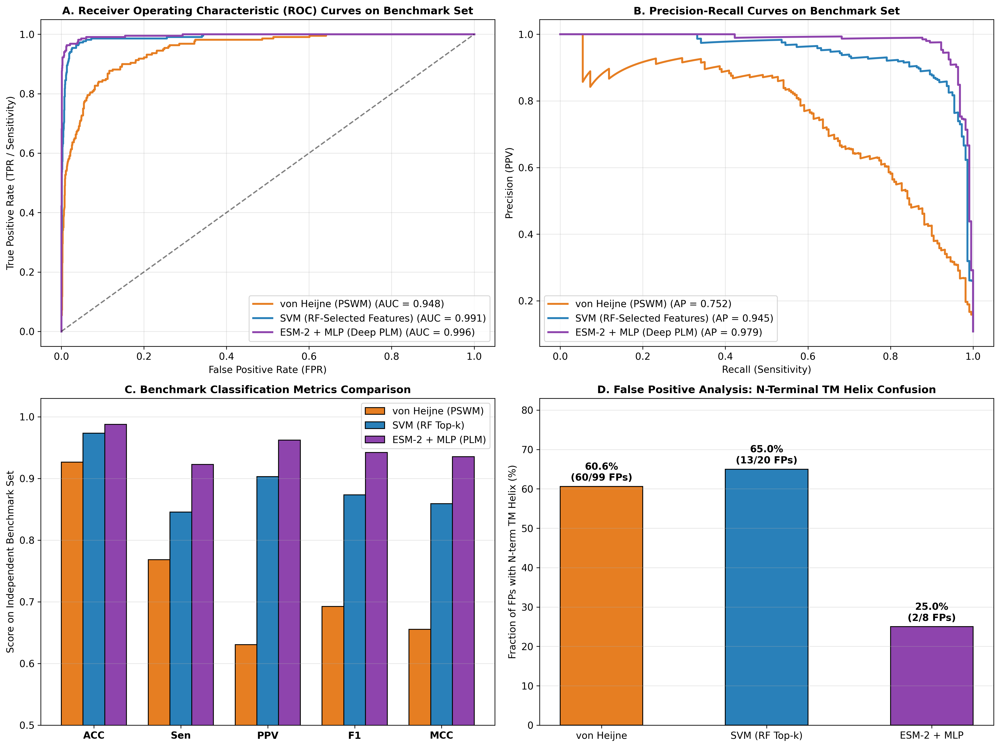
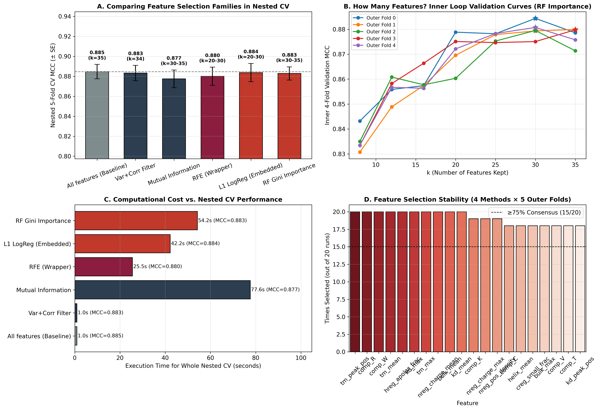
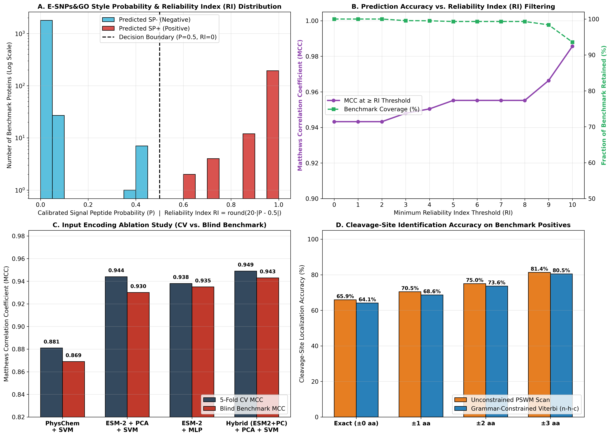

# 🧬 In-Silico Prediction of Eukaryotic Secretory Signal Peptides

> **University of Bologna (Alma Mater Studiorum)**  
> *Department of Pharmacy and Biotechnology (FaBiT)*  
> **Author:** Mohammadamin Roshan (MSc Student in Bioinformatics)  

---

## 📌 Project Overview

Welcome to my repository! This project tackles a fundamental challenge in bioinformatics: the **accurate computational detection of eukaryotic secretory signal peptides (SPs)**. 

The main hurdle in this field is **Transmembrane (TM) mimicry**. Because the hydrophobic cores of signal peptides and N-terminal transmembrane $\alpha$-helices are physicochemically very similar, models often confuse them. 

To systematically solve this, I developed and compared three different machine learning paradigms, increasing in complexity:
1. **Rule-Based Motif Scanning:** Using the classic von Heijne Position-Specific Weight Matrix (PSWM) as a baseline.
2. **Feature-Engineered Machine Learning:** An RBF-SVM trained on 35 extracted physicochemical descriptors, rigorously optimized using Nested Cross-Validation.
3. **Deep Representation Learning:** Deep MLP and hybrid PCA-SVM architectures that leverage advanced contextual embeddings from the pretrained **ESM-2 Protein Language Model (PLM)**.

---

## 🗂️ Pipeline Structure

The entire project is structured into a reproducible, 7-step pipeline:

* `step1_Data_Collection/`: Automated data retrieval via UniProtKB REST API.
* `step2_data_preparation/`: Sequence clustering (MMseqs2) and stratified 80/20 data partitioning.
* `step3_data_analysis/`: Exploratory Data Analysis (EDA) and Sequence Logos generation.
* `step4_von_heijne/`: Baseline PSWM implementation and threshold optimization.
* `step5_svm/`: Rigorous feature selection (RF Gini) and SVM training.
* `step6_deep_learning/`: ESM-2 feature extraction, PCA dimensionality reduction, and neural network training.
* `step7_bologna_advanced_pipeline/`: Final advanced analysis including dual-thresholding, RI calibration, Viterbi decoding, and McNemar's statistical testing.

---

## 📊 Key Results & Visual Diagnostics

Below are the most critical visual diagnostics highlighting the performance of the final models on the blind benchmarking set ($N = 2,037$):

**Performance Summary:**
* **von Heijne PSWM Baseline:** $\text{MCC} = 0.655$
* **Physicochemical SVM:** $\text{MCC} = 0.859$
* **Hybrid ESM-2 PLM:** $\text{MCC} = 0.943$ | $\text{ROC-AUC} = 99.37\%$

### 1. Master Model Benchmark Comparison
This figure compares the final predictive power of our different model architectures:

### 2. SVM Feature Selection Diagnostics
This plot demonstrates the stability and performance of the selected physicochemical features via Nested CV:

### 3. Advanced Pipeline & Error Analysis
This final diagnostic shows how the ESM-2 representations dramatically reduced false-positive rates caused by TM-helices compared to the baseline:

---

## 📄 Final Manuscript

* **`13.docx`**: The complete methodology and benchmark results are documented in this final manuscript file located in the root directory.

---

## 📬 Contact

**Mohammadamin Roshan**  
*MSc Student in Bioinformatics, University of Bologna*  
* [LinkedIn Profile](https://www.linkedin.com/in/mohammadaminroshan/)